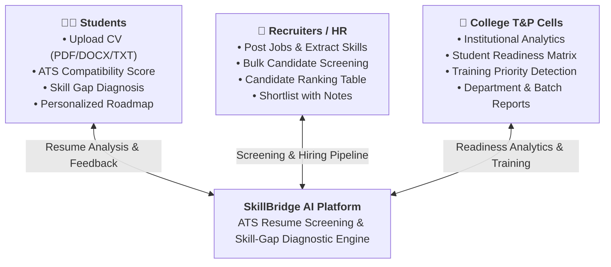
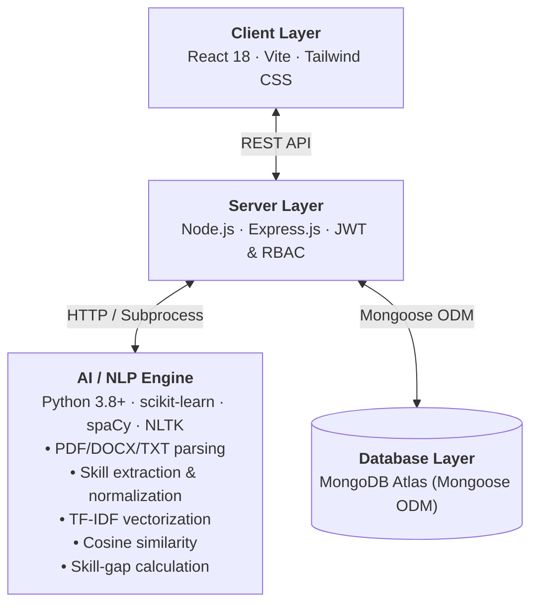

# SkillBridge AI 🎯

### ATS Resume Screening & Skill-Gap Diagnostic Platform

[](LICENSE)
[](https://nodejs.org)
[](https://reactjs.org)
[](https://python.org)
[](https://mongodb.com)

---

## 📌 Project Description

**SkillBridge AI** is a complete, production-style final-year B.Tech Computer Science major project. It is an **ATS Resume Screening & Skill-Gap Diagnostic Platform** that creates a **Three-Way Bridge** connecting:

- 👨‍🎓 **Students** — Resume analysis, skill-gap diagnosis, learning roadmaps
- 🏢 **Recruiters/HR** — Candidate screening, bulk analysis, shortlisting
- 🏫 **College T&P Cells** — Institutional analytics, placement readiness, training priorities

---

## 🎯 Problem Statement

Modern hiring processes rely heavily on ATS (Applicant Tracking System) tools that filter candidates automatically before human review. Students often lack visibility into:
1. How their resumes perform against job requirements
2. Which specific skills are missing
3. How to bridge their skill gaps systematically

Simultaneously, college placement cells lack a centralized system to understand student readiness and plan targeted training programs.

---

## 🔬 Research Gap

Existing resume screening tools either:
- Show only a generic score without explanation
- Do not provide actionable skill-gap diagnosis
- Lack integration with placement cell analytics
- Do not support three-way visibility (student + recruiter + institution)

SkillBridge AI addresses this gap by creating an integrated, explainable, and institutionally-aware platform.

---

## 🎯 Objectives

1. Implement an academic NLP-based ATS compatibility engine (TF-IDF + Cosine Similarity)
2. Provide transparent, explainable ATS results
3. Diagnose skill gaps at four levels: Strong, Moderate, Priority, Recommended
4. Generate personalized learning roadmaps and capstone project recommendations
5. Enable recruiter-side candidate screening with human oversight
6. Provide T&P cells with institutional analytics and training priority detection
7. Implement secure RBAC with four user roles
8. Build a premium React-based UI with dark/light mode support

---

## 🌉 Three-Way Bridge Architecture



```text
+-------------------------------------------------------------+
|                       SkillBridge AI                        |
|                  ATS & Skill-Gap Platform                   |
+-------------------------------------------------------------+
         ^                          ^                          ^
         |                          |                          |
         v                          v                          v
+-----------------+        +------------------+        +---------------+
| 👨‍🎓 Students    |        | 🏢 Recruiters/HR |        | 🏫 T&P Cells  |
|                 |        |                  |        |               |
| - Upload CV     |        | - Post Jobs      |        | - Analytics   |
| - ATS Score     |        | - Screen CVs     |        | - Readiness   |
| - Skill Gap     |        | - Shortlist      |        | - Training    |
| - Roadmap       |        | - Compare        |        | - Reports     |
+-----------------+        +------------------+        +---------------+
```

---

## ✨ Features

### 🎓 Student Features
- Resume upload (PDF, DOCX, TXT)
- Structured resume parsing with preview
- ATS compatibility scoring (TF-IDF + Cosine Similarity)
- Explainable results (why you matched, what is missing)
- Four-tier skill classification (Strong / Moderate / Priority / Recommended)
- Resume quality analysis
- Personalized learning roadmap
- Capstone project recommendations
- Career pathway compatibility
- Resume version history
- Analysis history & comparison
- Downloadable PDF report
- Career readiness score

### 🏢 Recruiter Features
- Job posting creation
- JD skill extraction
- Bulk resume upload & analysis
- Candidate ranking table
- ATS score, matched/missing skills per candidate
- Shortlisting with notes
- Human-review-first design
- Candidate comparison

### 🏫 T&P Cell Features
- Institutional analytics dashboard
- Role-wise student readiness
- Department & batch analytics
- Skill gap frequency charts
- Training priority detection
- Student readiness matrix
- Historical improvement tracking

### 🔒 Admin Features
- User management
- Canonical skill management
- Skill alias management
- Career role management
- Learning resource management
- Capstone project management
- Audit logs
- Algorithm version tracking

---

## 🏗️ System Architecture



```text
+-------------------------------------------------------------+
|            Client Layer (React 18 + Vite + Tailwind CSS)    |
+-------------------------------------------------------------+
                              |
                              | REST API (HTTP / JSON)
                              v
+-------------------------------------------------------------+
|             Server Layer (Node.js + Express.js)             |
+-------------------------------------------------------------+
               |                               |
               | HTTP / subprocess             | Mongoose ODM
               v                               v
+-------------------------------+  +--------------------------+
|      Python AI/NLP Engine     |  |   MongoDB Atlas (Cloud)  |
| - PDF/DOCX/TXT parsing        |  |   Database Layer         |
| - Skill extraction            |  +--------------------------+
| - TF-IDF vectorization        |
| - Cosine similarity scoring   |
| - 4-Tier skill-gap diagnostic |
+-------------------------------+
```

---

## 🛠️ Technology Stack

| Layer | Technology |
|-------|-----------|
| Frontend | React 18, Vite, Tailwind CSS |
| Icons | Lucide React |
| Charts | Recharts |
| Backend | Node.js, Express.js |
| Authentication | JWT, bcryptjs |
| Database | MongoDB Atlas (Mongoose ODM) |
| File Upload | Multer |
| Security | Helmet, CORS, express-rate-limit |
| AI/NLP | Python 3, scikit-learn, spaCy |
| PDF Parsing | PyMuPDF (fitz), python-docx |
| NLP | NLTK, scikit-learn (TF-IDF) |

---

## 📐 AI/NLP Methodology

### TF-IDF Vectorization

```text
TF-IDF(t, d) = TF(t, d) × IDF(t)

where:
  TF(t, d)  = frequency of term t in document d
  IDF(t)    = log(N / df(t)) + 1
  N         = total number of documents
  df(t)     = number of documents containing term t
```

### Cosine Similarity

```text
cos(θ) = (R · J) / (||R|| × ||J||)

where:
  R = TF-IDF vector of resume
  J = TF-IDF vector of job description
  θ = angle between vectors
```

The similarity is converted to an ATS Compatibility Percentage.

> ⚠️ **Academic Disclaimer**: ATS Compatibility Score represents similarity calculated by SkillBridge AI using TF-IDF + Cosine Similarity. This is an academic indicator and may differ from proprietary employer ATS systems.

### Skill-Gap Calculation

```text
Missing Skills = Required JD Skills - Extracted Resume Skills

Four-Tier Classification:
  Strong      → Score ≥ 0.8 in skill match
  Moderate    → Score 0.5–0.79 in skill match
  Priority    → Score < 0.5 but in top JD requirements
  Recommended → Useful but not core JD requirements
```

---

## 👥 User Roles

| Role | Description |
|------|-------------|
| Student | Upload resumes, view analysis, access roadmap |
| Recruiter | Create jobs, screen candidates, shortlist |
| T&P Admin | View institutional analytics, manage training |
| Super Admin | Full system access, skill management, audit logs |

---

## 📁 Project Structure

```text
skillbridge-ai/
|-- client/                   # React + Vite Frontend
|   |-- src/
|   |   |-- components/       # Reusable UI components
|   |   |-- pages/            # Page components
|   |   |-- layouts/          # Layout wrappers
|   |   |-- hooks/            # Custom React hooks
|   |   |-- services/         # API service layer
|   |   |-- context/          # React context providers
|   |   |-- utils/            # Utility functions
|   |   |-- charts/           # Chart components
|   |   `-- assets/           # Static assets
|   `-- package.json
|
|-- server/                   # Node.js Backend
|   |-- src/
|   |   |-- controllers/      # Route handlers
|   |   |-- routes/           # Express routes
|   |   |-- models/           # Mongoose models
|   |   |-- middleware/       # Custom middleware
|   |   |-- services/         # Business logic
|   |   |-- utils/            # Utilities
|   |   |-- config/           # Configuration
|   |   `-- validators/       # Input validation
|   |-- ai/                   # Python AI/NLP Module
|   |   |-- parser/           # Resume/JD parsers
|   |   |-- nlp/              # NLP preprocessing
|   |   |-- matching/         # TF-IDF matching engine
|   |   |-- skills/           # Skill dictionary
|   |   `-- requirements.txt
|   |-- uploads/              # File storage
|   `-- .env.example
|
|-- docs/                     # Documentation
`-- README.md
```

---

## 🚀 Installation & Setup

### Prerequisites

- Node.js 18+
- Python 3.8+
- MongoDB Atlas account

### 1. Clone the Repository

```bash
git clone https://github.com/zaidimam15/skillbridge-ai.git
cd skillbridge-ai
```

### 2. Environment Variables

```bash
# Server
cp server/.env.example server/.env
# Fill in your MongoDB Atlas URI, JWT secret, etc.
```

### 3. Install Backend Dependencies

```bash
cd server
npm install
```

### 4. Install Python AI Dependencies

```bash
cd server/ai
pip install -r requirements.txt
python -m spacy download en_core_web_sm
python -m nltk.downloader stopwords punkt
```

### 5. Install Frontend Dependencies

```bash
cd client
npm install
```

### 6. Database Setup

The MongoDB collections are created automatically via Mongoose models. Run the seed script for demo data:

```bash
cd server
npm run seed
```

### 7. Run the Application

```bash
# Terminal 1: Backend
cd server
npm run dev

# Terminal 2: Frontend
cd client
npm run dev
```

---

## 🔑 Environment Variables

See `server/.env.example` for all required variables:

```env
NODE_ENV=development
PORT=5000
MONGODB_URI=mongodb+srv://...
JWT_SECRET=your_jwt_secret_here
JWT_EXPIRES_IN=7d
CLIENT_URL=http://localhost:5173
UPLOAD_MAX_SIZE=5242880
```

---

## 📡 API Documentation

### Authentication
| Method | Endpoint | Description |
|--------|----------|-------------|
| POST | `/api/auth/register` | Register new user |
| POST | `/api/auth/login` | Login |
| GET | `/api/auth/me` | Get current user |
| POST | `/api/auth/logout` | Logout |

### Resumes
| Method | Endpoint | Description |
|--------|----------|-------------|
| POST | `/api/resumes/upload` | Upload resume |
| GET | `/api/resumes` | Get user's resumes |
| GET | `/api/resumes/:id` | Get resume by ID |
| DELETE | `/api/resumes/:id` | Delete resume |

### Analysis
| Method | Endpoint | Description |
|--------|----------|-------------|
| POST | `/api/analysis` | Run ATS analysis |
| GET | `/api/analysis/history` | Get analysis history |
| GET | `/api/analysis/:id` | Get analysis by ID |
| GET | `/api/analysis/:id/report` | Download report |

### Jobs
| Method | Endpoint | Description |
|--------|----------|-------------|
| POST | `/api/jobs` | Create job |
| GET | `/api/jobs` | Get all jobs |
| GET | `/api/jobs/:id` | Get job by ID |
| PUT | `/api/jobs/:id` | Update job |
| DELETE | `/api/jobs/:id` | Delete job |

---

## 🔒 Security

- JWT authentication with refresh token strategy
- Passwords hashed with bcryptjs (12 rounds)
- Role-based access control (RBAC)
- Helmet security headers
- CORS configuration
- Rate limiting (100 req/15min)
- Input validation and sanitization
- File type & size validation
- SQL/NoSQL injection protection
- XSS protection
- Audit logging

---

## ⚖️ Privacy & Responsible AI

- Resumes contain sensitive personal data — stored securely
- User-controlled data deletion
- No sensitive attributes (gender, caste, religion, race) used in matching
- AI assists human decision-making; never auto-rejects candidates
- All AI-assisted actions logged for transparency
- Explicit disclaimer shown on all ATS scores

---

## 🔮 Future Scope

- Semantic embedding matching (BERT/Sentence-Transformers)
- LinkedIn profile import
- Video interview analysis
- Real-time job market API integration
- Mobile application
- Email notifications
- Advanced analytics with ML predictions

---

## ⚠️ Limitations

- ATS scores are academic indicators, not employer-grade ATS guarantees
- Scanned PDFs (image-based) may not parse correctly
- Salary and market data are from configurable seed data, not real-time APIs
- Semantic matching is future work; current implementation uses TF-IDF

---

## 📊 Academic Integrity

All performance metrics and statistics in this project are:
- Based on the implemented algorithm
- Validated on test data
- Clearly labeled as demo data where applicable
- Not fabricated or inflated

Final quantitative performance values will be reported after controlled testing per academic evaluation guidelines.

---

## 👥 Team

- **Developer**: MD Zaid Imam
- **Supervisor**: [Supervisor Name]
- **Institution**: IMS Engineering College, Ghaziabad
- **Batch**: 2027

---

## 📄 License

MIT License — see [LICENSE](LICENSE) for details.

---

*SkillBridge AI — Bridging the gap between education and employment.*
